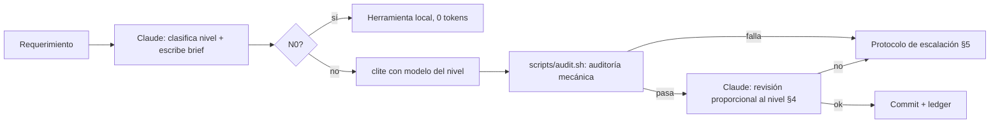

# Estrategia ClinePass v2: Claude Code arquitecto/auditor + `clite` ejecutor

Objetivo: salidas de calidad de producción al menor consumo de cuota **de ambos lados**
(Claude Code y ClinePass), sin falsas economías.

- **Claude Code** = arquitecto, clasificador, auditor. Piensa y verifica; no explora ni implementa en bloque.
- **`clite`** (comando de Cline CLI) = ejecutor, con el modelo del nivel asignado (ver `docs/modelos.md`).
- Los IDs de modelo viven **solo** en `docs/modelos.md`. Este documento habla de niveles.

> **First-time-right:** el ahorro real es una solución correcta al primer intento. El retrabajo cuesta más cuota que usar el nivel adecuado desde el inicio.

## 1. Flujo

## 2. Clasificación de nivel

Clasifica Claude al escribir el brief, usando **riesgo, no volumen**. Un cambio transversal hereda el nivel de su pieza más crítica.

**Señales de N3** (cualquiera basta): dinero/cobros/tarifas, permisos/autenticación, concurrencia/transacciones, esquema o migraciones de DB, contratos públicos (API/tipos exportados), máquinas de estado.
La lista concreta de dominios críticos del proyecto va en `docs/dominios-criticos.md` (específica por proyecto; este protocolo es genérico).

| Nivel | Clase de trabajo | Ejecutor |
| :-- | :-- | :-- |
| N0 | Formato, orden de imports, lint autofix | Herramientas locales, 0 tokens LLM |
| N1 | Boilerplate, fixtures, docs, cambios tipográficos con test existente | Modelo N1. **Prohibido** diseñar lógica o tests |
| N2 | Features, UI, endpoints/CRUD, integraciones, baterías de tests | Modelo N2 |
| N3 | Dominio crítico y contratos | Modelo N3 + revisión completa de Claude |
| Transversal | Cambia varios módulos | Nivel de su pieza más crítica + fase previa de mapeo de consumidores |

Ante duda: subir un nivel **solo** si hay una señal de N3. Si no, quedarse en el nivel inferior (la escalación cubre el error).

## 3. Brief de tarea (contrato con clite)

Todo encargo se hace con `docs/templates/brief.md`: objetivo, archivos en/fuera de alcance, contexto mínimo pegado, criterios verificables, comandos de verificación, prohibiciones y formato de reporte (≤15 líneas).
Un contexto acotado ahorra tokens a clite y evita que un modelo barato se pierda explorando el repo.

**Independencia de tests (N2/N3):** los tests de aceptación se derivan del brief, no de la implementación. Preferido: Claude escribe los tests de aceptación (pocos tokens) y clite implementa hasta ponerlos en verde; alternativa: otro modelo escribe los tests. Mismo modelo escribiendo código y tests hereda sus puntos ciegos.

## 4. Auditoría proporcional (ahorra tokens de Claude)

Siempre, para todo nivel: `scripts/audit.sh <base> [allowlist]` — patrones prohibidos, assertions que no disminuyan, archivos fuera de alcance, typecheck/lint/test con salida filtrada. Claude **no** lee el diff completo para esto.

| Nivel | Revisión de Claude tras audit.sh OK |
| :-- | :-- |
| N0/N1 | Ninguna adicional (mirar `--stat`) |
| N2 | Leer solo hunks de lógica y tests nuevos; contrastar con criterios de aceptación |
| N3 | Lectura completa, contraste con invariantes, regresión y contratos públicos |

El reporte final de clite es el único texto que Claude ingiere de la ejecución; nunca logs completos.

## 5. Guardrails anti-deuda técnica

Prohibido: `any`/`as unknown as` injustificados, `@ts-ignore`/`@ts-nocheck`/`eslint-disable`, debilitar o borrar assertions.
**Excepción**: solo con entrada `D-XX` en `docs/decisiones.md` aprobada por el arquitecto (evita que la regla rígida empuje a esquivarla).

## 6. Escalación

Escalera única: **N1 → N2 → N3 → Claude Code resuelve/interviene → Stop & Ask (usuario)**.

1. Fallo conceptual, de seguridad o de contrato → directo a N3.
2. Fallo local, causa clara y acotada → **1** reintento en el mismo nivel.
3. Reaparición, regresión o causa incierta → siguiente nivel de la escalera.
4. Fallo de entorno/infra (red, deps, tooling) → arreglar entorno antes de tocar código o cambiar de modelo.
5. N3 sin evidencia suficiente → Claude toma la tarea o Stop & Ask con diagnóstico completo.

Paquete de escalación: requerimiento e invariantes, contratos afectados, diff intentado, log del fallo (cola filtrada) e hipótesis.

**Cortacircuitos por tarea:** tope de tiempo/turnos (p. ej. `timeout 20m clite ...` o flag nativo si existe). Si se excede, cuenta como fallo y escala.

## 7. Calibración con datos

Cada tarea agrega una línea a `docs/ledger.csv` (nivel, modelo, intentos, escalación, ¿pasó auditoría al primer intento?, motivo).
Cada ~20 tareas revisar: un modelo pasa de `por validar` a `validado` para un tipo de tarea si su tasa de éxito al primer intento es consistentemente alta; si falla seguido, se sube el nivel de ese tipo de tarea. Así "evidencia de suficiencia" es operativa, no declarativa.

## 8. Operación y seguridad

- Un branch o worktree por tarea, un commit por tarea: diff aislado y revert trivial.
- clite en modo autónomo: sin acceso a `.env`/secretos, sin `push` (lo decide Claude o el usuario), comandos acotados a los del brief.
- Cuota (ventanas de 5 h, semanal, mensual): agrupar N3 cuando hay holgura; N1/N0 absorben los momentos de cuota justa. Si se agota: pausar, o limitar a N0/N1; nunca bajar el nivel de una tarea N2/N3 por falta de cuota.
- Contexto de repo para clite: un archivo corto de reglas del proyecto (convenciones, comandos, prohibiciones) leído siempre; el resto se pasa por brief.
- Decisiones técnicas relevantes: registrar `D-XX` en `docs/decisiones.md`.
